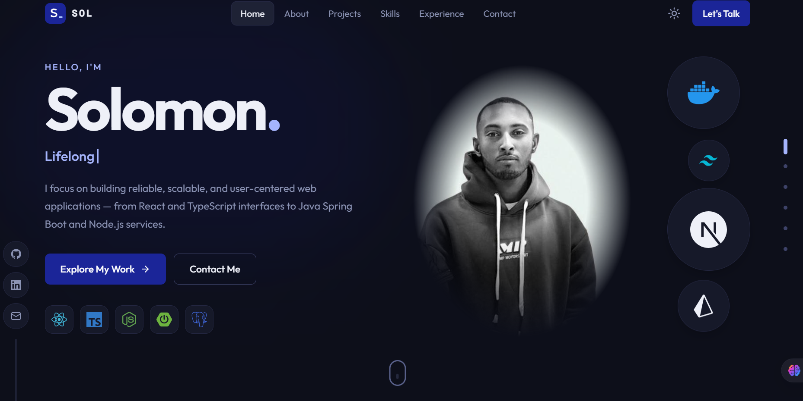

# Portfolio

Personal portfolio of Solomon Shmels, a full-stack developer. It presents my projects, skills, experience, and a contact form in a fast, accessible single-page site.

**Live site:** https://portfolio-alpha-wheat-udl67twlon.vercel.app



## Features

- Hero, about, skills, experience, approach, and projects sections
- Interactive "about" terminal
- Project cards with screenshots and links
- Contact form with validation (Formspree endpoint, or falls back to the visitor's email app)
- Light and dark themes
- Downloadable CV
- Security headers and long-lived asset caching on Vercel

## Tech stack

React 19, TypeScript, Vite, Tailwind CSS 4, Framer Motion, Vitest, ESLint. Deployed on Vercel.

## Getting started

Prerequisite: Node.js 20+.

```bash
npm install
npm run dev        # http://localhost:5173
```

Other scripts:

| Command | What it does |
| --- | --- |
| `npm run build` | Type-check and build for production |
| `npm run preview` | Preview the production build |
| `npm test` | Run unit tests |
| `npm run lint` | Run ESLint |

## Environment variables

Optional. Copy `.env.example` to `.env.local`.

| Variable | Purpose |
| --- | --- |
| `VITE_CONTACT_ENDPOINT` | Form endpoint for contact messages (for example, Formspree) |
| `VITE_SITE_URL` | Public site URL for link previews and the canonical URL |

## Featured projects

- [Phone Repair Management System](https://github.com/Sol-Reactor/prms-phone-repair-management-system-)
- [School Management (Haya)](https://github.com/Sol-Reactor/school-management)
- [MyQuiz](https://github.com/Sol-Reactor/MyQuiz)

## Author

[Solomon Shmels](https://github.com/Sol-Reactor)
